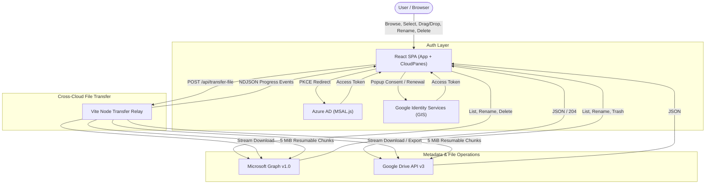

# Architecture — Multi-Cloud Explorer v1.3

## Overview

A **React + Vite** dual-pane web application with direct browser integration to **Microsoft Graph API (OneDrive)** and **Google Drive API v3**, enhanced by a lightweight, zero-dependency **local Vite Node transfer relay** (`/api/transfer-file`) that streams files cloud-to-cloud without hitting browser CORS limits or ~10 MB `fetch().blob()` stream caps.

---

## System Data Flow



---

## Component Architecture

The application uses a 3-column CSS Grid shell (`Sidebar` | `OneDrive Pane` | `Google Drive Pane`) plus floating overlays (`TransferToast`, `ConfirmModal`, `RenameModal`).

```text
App.jsx (Root Coordinator: Auth, Batch Drag State, Transfer/Delete Workers, Modals, Refresh Keys)
├── Sidebar (Account Profiles, Independent Logouts, Copy/Move Mode Switch)
├── OneDrive Pane (CloudPane instance: type="onedrive")
│   ├── Header (Breadcrumbs) + Selection Pill + Rename / Delete / Refresh Actions
│   ├── FileList (Select-All Header) → FileItem (Checkbox, Multi-Select, Draggable, Subfolder Drop Target)
│   └── Live Drop Preview Banner (Single or N items, Copy / Move + Shift Hint)
├── Google Drive Pane (CloudPane instance: type="google")
│   ├── Header (Breadcrumbs) + Selection Pill + Rename / Delete / Refresh Actions
│   ├── FileList (Select-All Header) → FileItem (Checkbox, Multi-Select, Draggable, Subfolder Drop Target)
│   └── Live Drop Preview Banner (Single or N items, Copy / Move + Shift Hint)
├── TransferToast (Floating Activity Queue: Copy / Move / Delete / Rename Badges, Progress, Warnings)
├── ConfirmModal (Single & Multi-Item Delete Confirmation Dialog)
└── RenameModal (Extension-Preserving Rename Dialog with Inline Validation)
```

### Reusable `CloudPane` Pattern
`CloudPane.jsx` encapsulates:
- Independent folder navigation and breadcrumb state.
- Multi-item selection (`Set` of active IDs intersected with current items, `Ctrl/Cmd+Click`, `Shift+Click` range select, Select All, `Esc` to clear, automatic reset on navigation).
- Contextual action buttons: **Rename** (`F2`, when 1 item selected), **Delete** (`Del`, when 1+ items selected), and **Refresh**.
- Batch drag-and-drop initiation (dragging any selected item drags the entire selection with a custom `N items` ghost badge) and drop handling (pane-level or direct subfolder drop).
- Live `Shift`-key modifier preview switching Copy ↔ Move.
- Data fetching via provider-specific hooks (`useDriveItems` / `useGoogleDriveItems`) with `refreshKey` and Google `401` expiry callbacks.

---

## Operations & Transfer Engine (`transferService.js` + `vite.config.js`)

1. **Single & Batch Cross-Cloud Transfers**:
   - Dropped batches are queued in `App.jsx` and processed by a worker pool (**concurrency = 2**), displaying active items with live progress bars and waiting items as `Queued…`.
   - For each file, `transferSingleFile` resolves a download descriptor (`@microsoft.graph.downloadUrl` fetched without `$select` for OneDrive; `?alt=media` or `/export` for Google Workspace docs) and calls `POST /api/transfer-file` on the Vite server (`configureServer` & `configurePreviewServer`).
   - Node validates the source URL against a strict HTTPS allowlist of official Microsoft/OneDrive (`my.microsoftpersonalcontent.com`, `graph.microsoft.com`, `*.1drv.com`, `*.sharepoint.com`, etc.) and Google (`*.googleapis.com`) domains, and only forwards `Authorization` headers to `graph.microsoft.com` or `www.googleapis.com`.
   - Node downloads the source stream and uploads to the target using **5 MiB resumable chunks** (`createUploadSession` for OneDrive; `uploadType=resumable` with `redirect: 'manual'` for Google Drive `308 Resume Incomplete`), streaming NDJSON progress updates back to the browser.
   - Automatically falls back to direct browser download/upload if `/api/transfer-file` is unavailable (e.g., static hosting).
2. **Recursive Folder Transfer**:
   - Scans the source folder tree (up to depth 20) to compute accurate total file counts, recreates folders at the destination, and transfers nested files sequentially.
   - Records per-file warnings without aborting remaining files; in `move` mode, the original folder is deleted/trashed only if zero warnings occurred.
3. **Delete & Rename**:
   - **Delete**: `ConfirmModal` previews up to 6 item names (+ overflow count). On confirm, a worker pool (**concurrency = 3**) calls `DELETE /me/drive/items/{id}` (OneDrive Recycle Bin) or `PATCH /files/{id} { trashed: true }` (Google Drive Trash), logging each result in `TransferToast`.
   - **Rename**: `RenameModal` auto-selects the filename stem (preserving file extensions), validates OneDrive forbidden characters inline, and executes `PATCH /me/drive/items/{id}` (OneDrive) or `PATCH /files/{id}` (Google Drive).

---

## Folder Structure

```text
onedrive-explorer/
├── docs/
│   ├── APPLICATION_SPEC.md
│   └── ARCHITECTURE.md
├── vite.config.js                    # Vite config + /api/transfer-file streaming relay
├── src/
│   ├── api/
│   │   ├── graphService.js           # MS Graph API (list, download descriptor, upload, folder, rename, delete)
│   │   ├── googleDriveService.js     # Google Drive API v3 (list, export/download, upload, folder, rename, trash)
│   │   └── transferService.js        # Cross-cloud transfer, folder recursion, delete & rename helpers
│   ├── auth/
│   │   ├── authService.js            # Deduplicated MSAL token & redirect helper
│   │   ├── msalConfig.js             # MSAL config (User.Read, Files.ReadWrite)
│   │   └── googleAuthService.js      # GIS config (drive scope + smooth token renewal)
│   ├── components/
│   │   ├── CloudPane/                # Dual-purpose explorer pane, multi-select, actions & DnD
│   │   ├── ConfirmModal/             # Delete confirmation dialog
│   │   ├── FileItem/                 # Checkbox + draggable file/folder rows + subfolder drop targets
│   │   ├── FileList/                 # Select-all header, item list & loading skeletons
│   │   ├── Header/                   # Breadcrumb trail
│   │   ├── RenameModal/              # Rename dialog with extension-aware selection & validation
│   │   ├── Sidebar/                  # Profiles, logouts, Copy/Move mode switch
│   │   └── TransferToast/            # Floating activity queue (Copy / Move / Delete / Rename)
│   ├── hooks/
│   │   ├── useDriveItems.js          # OneDrive data hook (with refreshKey)
│   │   └── useGoogleDriveItems.js    # Google Drive data hook (with refreshKey & 401 expiry callback)
│   └── utils/
│       ├── fileIcons.js              # Icon & label mapping (MS + Google Workspace)
│       └── formatters.js             # Byte size & ISO date formatters
```

---

## Auth & Token Management

| Cloud | Auth Method | Scopes | Token Storage & Expiry |
|---|---|---|---|
| **OneDrive** | Microsoft MSAL (PKCE) | `User.Read`, `Files.ReadWrite` | `sessionStorage` (silent token refresh via MSAL.js) |
| **Google Drive** | Google Identity Services (GIS) | `https://www.googleapis.com/auth/drive` | `sessionStorage` (~1 hour TTL; `401` auto-resets pane to one-click Sign-In with `prompt: ''`) |

---

## Known Limitations & Future Roadmap

- **Pagination**: Directory listings currently load the first 200 items (`$top=200` / `pageSize=200`); `@odata.nextLink` and `nextPageToken` pagination is planned next.
- **Static Hosting Large Files**: Pure static hosting without the Vite Node relay may encounter OneDrive CDN CORS blocks on certain large files — deploying a lightweight serverless relay (Cloudflare Worker / Vercel Function) or packaging in Electron solves this in production.
- **Google OAuth Testing Mode**: Google Cloud Console app is currently in Testing mode (test users must be listed in Google Auth Platform → Audience).
- **Upcoming Features**: Search & filtering, pagination, New Folder creation, file preview/download, and desktop packaging.
