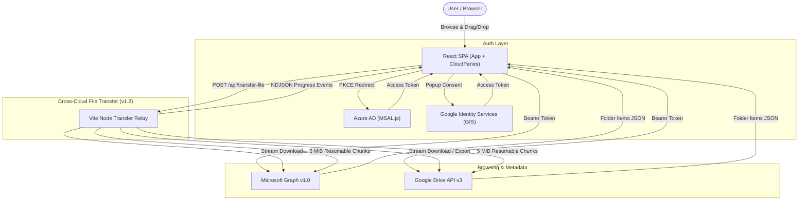

# Architecture — Multi-Cloud Explorer v1.2

## Overview

A **React + Vite** dual-pane web application with direct browser integration to **Microsoft Graph API (OneDrive)** and **Google Drive API v3**, enhanced by a lightweight, zero-dependency **local Vite Node transfer relay** (`/api/transfer-file`) that streams large files cloud-to-cloud without hitting browser CORS limits or ~10 MB `fetch().blob()` stream caps.

---

## System Data Flow



---

## Component Architecture

The application uses a 3-column CSS Grid shell (`Sidebar` | `OneDrive Pane` | `Google Drive Pane`) plus a floating `TransferToast` overlay.

```text
App.jsx (Root Coordinator: Auth, Drag State, Transfer Queue, Refresh Keys)
├── Sidebar (Account Profiles, Independent Logouts, Copy/Move Mode Switch)
├── OneDrive Pane (CloudPane instance: type="onedrive")
│   ├── Header (Breadcrumbs) + Refresh Button
│   ├── FileList → FileItem (Draggable + Subfolder Drop Target)
│   └── Live Drop Preview Banner (Copy / Move + Shift Hint)
├── Google Drive Pane (CloudPane instance: type="google")
│   ├── Header (Breadcrumbs) + Refresh Button
│   ├── FileList → FileItem (Draggable + Subfolder Drop Target)
│   └── Live Drop Preview Banner (Copy / Move + Shift Hint)
└── TransferToast (Floating Queue: Progress Bars, Warnings, Errors, Dismiss)
```

### Reusable `CloudPane` Pattern
`CloudPane.jsx` encapsulates:
- Independent folder navigation and breadcrumb state.
- Data fetching via provider-specific hooks (`useDriveItems` / `useGoogleDriveItems`) with `refreshKey` support.
- Drag-and-drop drop-zone detection (pane-level for current folder, plus `FileItem`-level for direct subfolder drops).
- Live `Shift`-key modifier preview switching Copy ↔ Move.
- Locked / Sign-In state when unauthenticated.

---

## Transfer Engine Architecture (`transferService.js` + `vite.config.js`)

1. **Single File Transfer**:
   - Resolves a download descriptor (`@microsoft.graph.downloadUrl` without `$select` for OneDrive, or `?alt=media` / `/export` for Google Drive Workspace docs).
   - Sends source & target descriptors to `POST /api/transfer-file` on the Vite server (`configureServer` & `configurePreviewServer`).
   - Node validates the source URL against a strict HTTPS allowlist of official Microsoft/OneDrive (`my.microsoftpersonalcontent.com`, `graph.microsoft.com`, `*.1drv.com`, `*.sharepoint.com`, etc.) and Google (`*.googleapis.com`) domains, and only forwards `Authorization` headers to `graph.microsoft.com` or `www.googleapis.com`.
   - Node downloads the source stream and uploads to the target using **5 MiB resumable chunks** (`createUploadSession` for OneDrive; `uploadType=resumable` with `redirect: 'manual'` for Google Drive `308 Resume Incomplete`), emitting NDJSON progress updates back to the browser.
   - Falls back automatically to direct browser download/upload if `/api/transfer-file` is not present (e.g., static hosting).
2. **Recursive Folder Transfer**:
   - Scans the source folder tree (up to depth 20) to compute accurate total file counts.
   - Recreates folders at the destination and transfers each nested file sequentially with live progress.
   - Records per-file warnings without aborting the remaining files.
3. **Move Semantics**:
   - Deletes/trashes the original item (`DELETE /me/drive/items/{id}` → Recycle Bin for OneDrive; `PATCH /files/{id} { trashed: true }` → Trash for Google Drive) **only** after the upload succeeds with zero warnings.

---

## Folder Structure

```text
onedrive-explorer/
├── docs/
│   ├── APPLICATION_SPEC.md
│   └── ARCHITECTURE.md
├── vite.config.js                    # Vite config + /api/transfer-file streaming relay
├── src/
│   ├── api/
│   │   ├── graphService.js           # MS Graph API (list, download descriptor, upload, folder, delete)
│   │   ├── googleDriveService.js     # Google Drive API v3 (list, export/download, upload, folder, trash)
│   │   └── transferService.js        # Cross-cloud file & recursive folder transfer orchestrator
│   ├── auth/
│   │   ├── authService.js            # Deduplicated MSAL token & redirect helper
│   │   ├── msalConfig.js             # MSAL config (User.Read, Files.ReadWrite)
│   │   └── googleAuthService.js      # GIS config (drive scope)
│   ├── components/
│   │   ├── CloudPane/                # Dual-purpose explorer pane + drag/drop handling
│   │   ├── FileItem/                 # Draggable file/folder rows + subfolder drop targets
│   │   ├── FileList/                 # File list + loading skeletons
│   │   ├── Header/                   # Breadcrumb trail
│   │   ├── Sidebar/                  # Profiles, logouts, Copy/Move mode switch
│   │   └── TransferToast/            # Floating cross-cloud transfer queue & progress UI
│   ├── hooks/
│   │   ├── useDriveItems.js          # OneDrive data hook (with refreshKey)
│   │   └── useGoogleDriveItems.js    # Google Drive data hook (with refreshKey)
│   └── utils/
│       ├── fileIcons.js              # Icon & label mapping (MS + Google Workspace)
│       └── formatters.js             # Byte size & ISO date formatters
```

---

## Auth & Token Management

| Cloud | Auth Method | Scopes | Token Storage |
|---|---|---|---|
| **OneDrive** | Microsoft MSAL (PKCE) | `User.Read`, `Files.ReadWrite` | `sessionStorage` (Managed by MSAL.js) |
| **Google Drive** | Google Identity Services (GIS) | `https://www.googleapis.com/auth/drive` | `sessionStorage` (Managed by React state) |

---

## Known Limitations & Future Roadmap

- **Pagination**: Directory listings currently load the first 200 items (`$top=200` / `pageSize=200`); `@odata.nextLink` and `nextPageToken` pagination is planned next.
- **Static Hosting Large Files**: When deployed purely as static files without the Vite Node relay (e.g., GitHub Pages), browser CORS restrictions on personal OneDrive CDN shards may affect direct downloads of certain large files — deploying a lightweight serverless relay (e.g., Cloudflare Worker / Vercel Function) or packaging in Electron resolves this in production.
- **Google OAuth Testing Mode**: Google Cloud Console app is currently in Testing mode (test users must be listed in Google Auth Platform → Audience).
- **Upcoming Features**: Search & filtering, pagination, rename/delete/new-folder actions, and desktop packaging.
