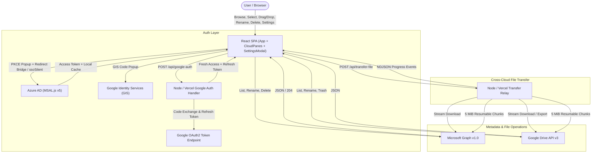

# Architecture — Multi-Cloud Explorer v1.5

## Overview

A **React + Vite** flexible dual-pane web application supporting **multiple simultaneous OneDrive and Google Drive accounts** with direct browser integration to **Microsoft Graph API (OneDrive)** and **Google Drive API v3**, paired with two lightweight, zero-dependency Node backend endpoints shared between **Vite dev/preview middleware** and **Vercel Serverless Functions**:
- `/api/transfer-file` (`server/transferRelay.js` + `api/transfer-file.js`): streams files account-to-account (OneDrive ↔ Google Drive, OneDrive ↔ OneDrive, or Google Drive ↔ Google Drive) with 5 MiB resumable chunks without hitting browser CORS limits or ~10 MB response body caps.
- `/api/google-auth` (`server/googleAuthHandler.js` + `api/google-auth.js`): exchanges Google GIS authorization codes for per-account refresh tokens and silently renews Google Drive access tokens on startup and before expiry.

---

## System Data Flow



---

## Component Architecture

The application uses a 3-column CSS Grid shell (`Sidebar` | `OneDrive Pane` | `Google Drive Pane`) plus floating overlays (`TransferToast`, `ConfirmModal`, `RenameModal`, `SettingsModal`).

```text
App.jsx (Root Coordinator: Multi-Account Auth Maps, Silent Refresh, Settings, Batch Drag, Workers, Modals)
├── Sidebar (All Saved OneDrive & Google Drive Accounts, Active L/R Tags, Copy/Move Switch, Settings Trigger)
├── Left Pane (CloudPane: paneId="left", Connection Pick List for any OneDrive or Google Drive)
│   ├── Connection Picker + Header (Breadcrumbs) + Selection Pill + Rename / Delete / Refresh Actions
│   ├── FileList (Select-All Header) → FileItem (Checkbox, Multi-Select, Draggable, Subfolder Drop Target)
│   └── Live Drop Preview Banner (Single or N items, Copy / Move + Shift Hint)
├── Right Pane (CloudPane: paneId="right", Connection Pick List for any OneDrive or Google Drive)
│   ├── Connection Picker + Header (Breadcrumbs) + Selection Pill + Rename / Delete / Refresh Actions
│   ├── FileList (Select-All Header) → FileItem (Checkbox, Multi-Select, Draggable, Subfolder Drop Target)
│   └── Live Drop Preview Banner (Single or N items, Copy / Move + Shift Hint)
├── TransferToast (Floating Activity Queue: Copy / Move / Delete / Rename Badges, Account Names, Progress)
├── ConfirmModal (Single & Multi-Item Delete Confirmation Dialog)
├── RenameModal (Extension-Preserving Rename Dialog with Inline Validation)
└── SettingsModal (Add/Rename/Remove Multiple OneDrive & Google Drive Accounts, OAuth Overrides, Preferences)
```

### Reusable `CloudPane` Pattern
`CloudPane.jsx` encapsulates:
- Independent folder navigation and breadcrumb state.
- Locked & auto-reconnecting states (`isConnecting` spinner, contextual auth notices, quick link to Connection Settings).
- Multi-item selection (`Set` of active IDs intersected with current items, `Ctrl/Cmd+Click`, `Shift+Click` range select, Select All, `Esc` to clear, automatic reset on navigation).
- Contextual action buttons: **Rename** (`F2`, when 1 item selected), **Delete** (`Del`, when 1+ items selected), and **Refresh**.
- Batch drag-and-drop initiation (dragging any selected item drags the entire selection with a custom `N items` ghost badge) and drop handling (pane-level or direct subfolder drop).
- Live `Shift`-key modifier preview switching Copy ↔ Move.
- Data fetching and progressive pagination via provider-specific hooks (`useDriveItems` / `useGoogleDriveItems`) following OneDrive `@odata.nextLink` and Google Drive `nextPageToken` with `IntersectionObserver` infinite scroll, **Load more / Load all**, `refreshKey`, and Google `401` expiry callbacks.

---

## Backend Endpoints & Transfer Engine (`server/` + `api/`)

Both backend handlers live in `server/` and are wired identically into **Vite** (`vite.config.js` via `configureServer` & `configurePreviewServer`, loading `.env` via `loadEnv`) and **Vercel Serverless Functions** (`api/*.js` + `vercel.json`):

1. **Google OAuth Refresh Endpoint (`/api/google-auth`)**:
   - `GET /api/google-auth`: reports whether `GOOGLE_CLIENT_SECRET` and `VITE_GOOGLE_CLIENT_ID` are configured on the server (never exposes secret values).
   - `POST /api/google-auth`: supports `exchange` (exchanges GIS `initCodeClient` popup auth code using `redirect_uri=postmessage`), `refresh` (exchanges stored `refresh_token` for a fresh access token), and `revoke`.
   - Always responds with `Cache-Control: no-store` and only communicates with hardcoded `https://oauth2.googleapis.com` endpoints.
2. **Single & Batch Cross-Cloud Transfers (`/api/transfer-file`)**:
   - Dropped batches are queued in `App.jsx` and processed by a worker pool (**concurrency = 2**), displaying active items with live progress bars and waiting items as `Queued…`.
   - For each file, `transferSingleFile` resolves a download descriptor (`@microsoft.graph.downloadUrl` fetched without `$select` for OneDrive; `?alt=media` or `/export` for Google Workspace docs) and calls `POST /api/transfer-file`.
   - Node validates the source URL against a strict HTTPS allowlist of official Microsoft/OneDrive (`my.microsoftpersonalcontent.com`, `graph.microsoft.com`, `*.1drv.com`, `*.sharepoint.com`, etc.) and Google (`*.googleapis.com`) domains, and only forwards `Authorization` headers to `graph.microsoft.com` or `www.googleapis.com`.
   - Node downloads the source stream and uploads to the target using **5 MiB resumable chunks** (`createUploadSession` for OneDrive; `uploadType=resumable` with `redirect: 'manual'` for Google Drive `308 Resume Incomplete`), streaming NDJSON progress updates back to the browser.
   - Automatically falls back to direct browser download/upload if `/api/transfer-file` is unavailable.
3. **Recursive Folder Transfer**:
   - Scans the entire source folder tree across all pagination pages (`@odata.nextLink` / `nextPageToken`, up to depth 20) to compute accurate total file counts without 200-item truncation, recreates folders at the destination, and transfers nested files sequentially.
   - Records per-file warnings without aborting remaining files; in `move` mode, the original folder is deleted/trashed only if zero warnings occurred.
4. **Delete & Rename**:
   - **Delete**: `ConfirmModal` previews up to 6 item names (+ overflow count). On confirm, a worker pool (**concurrency = 3**) calls `DELETE /me/drive/items/{id}` (OneDrive Recycle Bin) or `PATCH /files/{id} { trashed: true }` (Google Drive Trash), logging each result in `TransferToast`.
   - **Rename**: `RenameModal` auto-selects the filename stem (preserving file extensions), validates OneDrive forbidden characters inline, and executes `PATCH /me/drive/items/{id}` (OneDrive) or `PATCH /files/{id}` (Google Drive).

---

## Folder Structure

```text
onedrive-explorer/
├── api/
│   ├── google-auth.js                # Vercel Serverless Function wrapper for /api/google-auth
│   └── transfer-file.js              # Vercel Serverless Function wrapper for /api/transfer-file
├── docs/
│   ├── APPLICATION_SPEC.md
│   └── ARCHITECTURE.md
├── server/
│   ├── googleAuthHandler.js          # Shared Node handler for Google OAuth code exchange & refresh
│   └── transferRelay.js              # Shared Node handler for 5 MiB chunked streaming relay
├── vercel.json                       # Vercel build, function timeouts & SPA rewrites
├── vite.config.js                    # Vite config + local middleware for /api/transfer-file & /api/google-auth
├── src/
│   ├── main.jsx                      # MSAL v5 redirect-bridge handler, dynamic MSAL init & ssoSilent bootstrap
│   ├── App.jsx                       # Root coordinator: auth, silent refresh, settings, DnD, workers & modals
│   ├── api/
│   │   ├── graphService.js           # MS Graph API (paginated list, download descriptor, upload, folder, rename, delete)
│   │   ├── googleDriveService.js     # Google Drive API v3 (paginated list, export/download, upload, folder, rename, trash)
│   │   └── transferService.js        # Cross-account transfer, full-page folder recursion, delete & rename helpers
│   ├── auth/
│   │   ├── authService.js            # Multi-account MSAL login/logout & per-account token acquisition
│   │   ├── msalConfig.js             # Dynamic per-connection MSAL config builder
│   │   ├── msalRegistry.js           # Registry caching initialized MSAL instances per (clientId, authority, cache)
│   │   └── googleAuthService.js      # GIS code flow (select_account) + /api/google-auth refresh + token fallback
│   ├── components/
│   │   ├── CloudPane/                # Dual-purpose explorer pane, connecting state, multi-select, actions & DnD
│   │   ├── ConfirmModal/             # Delete confirmation dialog
│   │   ├── FileItem/                 # Checkbox + draggable file/folder rows + subfolder drop targets
│   │   ├── FileList/                 # Select-all header, item counts, infinite scroll & Load more/all footer
│   │   ├── Header/                   # Breadcrumb trail
│   │   ├── RenameModal/              # Rename dialog with extension-aware selection & validation
│   │   ├── SettingsModal/            # Connection Settings modal (multi-account, auto-connect, OAuth overrides)
│   │   ├── Sidebar/                  # Multi-account list, active L/R tags, Copy/Move switch, Settings button
│   │   └── TransferToast/            # Floating activity queue (Copy / Move / Delete / Rename)
│   ├── hooks/
│   │   ├── useDriveItems.js          # OneDrive paginated data hook (@odata.nextLink, loadMore, loadAll)
│   │   └── useGoogleDriveItems.js    # Google Drive paginated data hook (nextPageToken, loadMore, loadAll, 401 callback)
│   └── utils/
│       ├── fileIcons.js              # Icon & label mapping (MS + Google Workspace)
│       ├── formatters.js             # Byte size & ISO date formatters
│       └── settingsStorage.js        # Persistent Connection Settings & Google session storage manager
```

---

## Auth & Token Management

| Cloud | Auth Method | Scopes | Token Storage & Auto-Connect |
|---|---|---|---|
| **OneDrive** | Microsoft MSAL v5 (PKCE Popup + `@azure/msal-browser/redirect-bridge`, Redirect fallback) | `User.Read`, `Files.ReadWrite` | `localStorage` when Auto-Connect is enabled in Connection Settings (`sessionStorage` otherwise), with silent refresh and `ssoSilent` fallback using saved account hint |
| **Google Drive** | Google Identity Services (GIS Code Flow + `/api/google-auth`, fallback to GIS Token Client) | `https://www.googleapis.com/auth/drive` | `localStorage` with OAuth `refresh_token` when Auto-Connect & `GOOGLE_CLIENT_SECRET` are configured; proactively refreshes 3 minutes before expiry and silently reconnects on startup |

---

## Known Limitations & Future Roadmap

- **Vercel Serverless Limits**: Free Vercel Hobby plan functions have a 60s execution cap (`maxDuration: 60`) and payload limits; very large files transfer best on local Vite or upgraded serverless tiers.
- **Google OAuth Testing Mode**: While the Google Cloud OAuth app is in **Testing** mode, test users must be listed under **Google Auth Platform → Audience** and Google expires refresh tokens after **7 days** (publishing the app removes this 7-day limit).
- **Upcoming Features**: Search & filtering, New Folder creation, local file upload/download, folder compare/sync, file preview, and desktop packaging.
